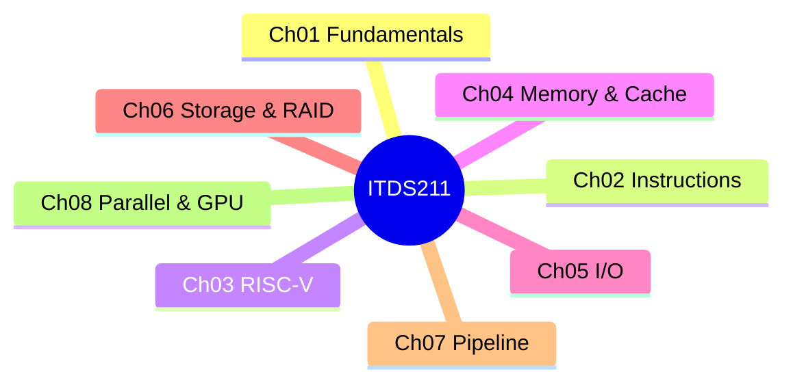

<div align="center">

# 🏛️ ITDS211 Computer Architecture

**สื่อเตรียมสอบกลางภาค · ปี 2 เทอม 1/2026 · คณะ ICT มหิดล**


### [🌐 เปิดหน้าเว็บ (GitHub Pages)](https://thinnaphat-tht.github.io/ITDS211-Computer-Architecture/)

</div>

---

## ✨ มีอะไรบ้าง

| สื่อ | รายละเอียด | เปิด |
|---|---|---|
| 🎓 สรุปคลาสติว | สรุป 5 คลิป + ข้อสอบฝึก **180 ข้อ** (6 ชุด × 30) พร้อมเฉลยสั้น/ยาว | [เปิด](https://thinnaphat-tht.github.io/ITDS211-Computer-Architecture/ITDS211-Tutoring-Summary.html) |
| 📘 สรุปทุกบท | Ch01–Ch08 ไทย + ศัพท์เทคนิคอังกฤษ | [เปิด](https://thinnaphat-tht.github.io/ITDS211-Computer-Architecture/ITDS211-Summary.html) |
| 📝 ข้อสอบฝึก | **90 ข้อ** 3 ชุด ตรวจคำตอบทันที | [เปิด](https://thinnaphat-tht.github.io/ITDS211-Computer-Architecture/ITDS211-Midterm-Quiz.html) |
| 📄 Cheatsheet | สูตร/กับดัก/แผนภาพ ปรินต์ 4 หน้า | [v2](ITDS211-Cheatsheet-v2.pdf) · [v1](ITDS211-Cheatsheet.pdf) |

## 📚 เนื้อหาที่ครอบคลุม



## 🗂️ โครงสร้าง repo

```
├── index.html                      หน้าแรก (Hub)
├── ITDS211-Tutoring-Summary.html   สรุปคลาสติว + ข้อสอบ 180 ข้อ (สร้างอัตโนมัติ)
├── ITDS211-Summary.html            สรุปทุกบท
├── ITDS211-Midterm-Quiz.html       ข้อสอบ 90 ข้อ
├── ITDS211-Cheatsheet*.pdf         Cheatsheet
├── tutoring-src/                   ต้นทางสรุปคลาสติว (clipN.py, quizN.py, build.py)
├── quiz-src/                       ต้นทางข้อสอบ 90 ข้อ (JSON + build.js)
├── cheatsheet-src/ · -v2/          ต้นทาง Cheatsheet (HTML parts)
└── CLAUDE.md                       บริบทงานสำหรับ Claude Code
```

## 🔧 สร้างใหม่ (build)

```bash
# ข้อสอบ 90 ข้อ
node quiz-src/build.js

# สรุปคลาสติว (ต้องมีสไลด์ PDF ของอาจารย์ในโฟลเดอร์ + pip install pymupdf)
cd tutoring-src
python -X utf8 build.py
```

## ⚠️ หมายเหตุ

- repo นี้ **ไม่รวม** สไลด์ PDF ของอาจารย์ และวิดีโอ/ซับคลาสติว (ลิขสิทธิ์ไม่ใช่ของผู้จัดทำ)
- เนื้อหาเป็นสื่อช่วยทบทวนส่วนตัว อาจมีข้อผิดพลาด โปรดเทียบกับสไลด์ต้นฉบับ
- ข้อความที่อ้างคำพูดอาจารย์มาจากซับคลาสติว ซึ่งเวลาอาจเพี้ยน

<div align="center"><sub>ทำโดย ทินภัทร · Mahidol ICT DST</sub></div>
